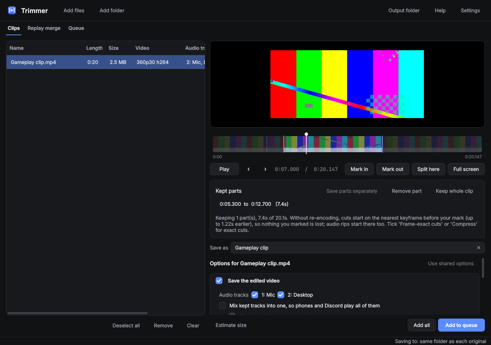
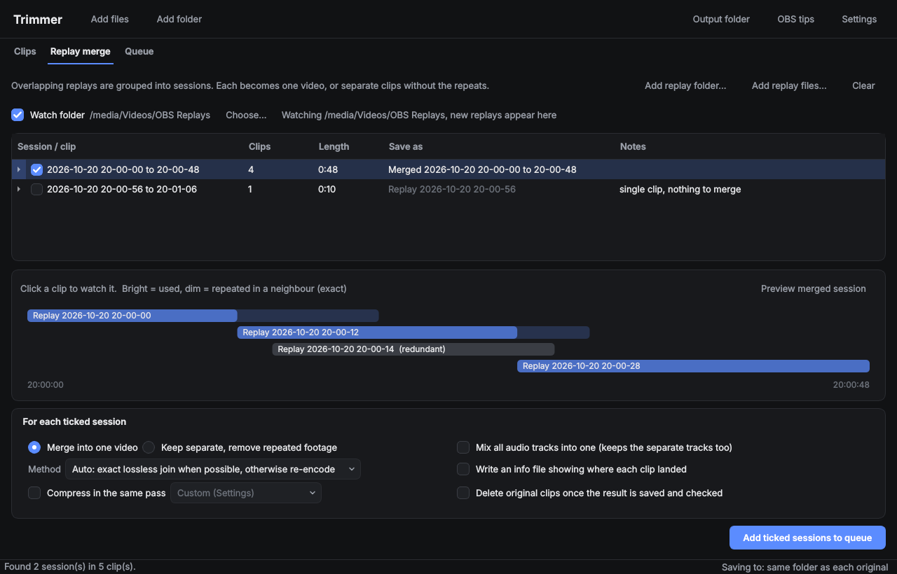

# Trimmer

Trim, merge, compress and rip OBS clips in one Windows desktop app. Built for
OBS Replay Buffer saves: overlapping replays are joined frame-exactly with no
repeated or lost footage, and trims can be frame-exact without re-encoding
the whole clip.



**Offline and private.** All the work is done by ffmpeg on your own PC, and
your clips never leave it. Trimmer has no telemetry and no online services.
The one exception is an optional update check, and it only runs if you say
yes:

- It asks GitHub for the latest Trimmer release, the same as opening the
  Releases page in a browser, and downloads the installer if you press
  Install update. Nothing about you, your clips or your settings is sent.
- The installer asks first: **Allow update checks** or **Local features
  only**. Local features only leaves the update code out entirely, so that
  copy of Trimmer has nothing that can connect to the internet. The portable
  zip asks the first time it opens, and does nothing unless you say yes.
- All of it is in one small file, `updater/trimmer_update.py`. Tests
  (`test_no_network_code`, `test_update_file_only_downloads_trimmer_releases`)
  fail if any other part of Trimmer uses the network, or if that file ever
  does more than download Trimmer's own releases.

## Author

Created by **KingZxi** ([github.com/KingZxi](https://github.com/KingZxi)).
© 2026 KingZxi. The same credit is in the app under Settings > About.

## Download (Windows)

1. Download `Trimmer-<version>-setup.exe` from the
   [Releases page](../../releases/latest) and run it. No admin rights are
   needed. Prefer no installer? Take `Trimmer-<version>-portable.zip`, unzip it
   anywhere and run `Trimmer.exe`.
2. Trimmer needs ffmpeg. On first launch it explains how to get it: run
   `winget install Gyan.FFmpeg`, or download a Windows build from ffmpeg.org
   and pick its `bin` folder (or put it in a folder named `ffmpeg` next to
   Trimmer). A "full" build enables the measured auto quality (auto3).

Settings and the queue are kept in `%APPDATA%\Trimmer`, so updating or
uninstalling leaves them alone.

The download isn't code-signed yet. Windows SmartScreen may show "Windows
protected your PC": click **More info**, then **Run anyway**. If Smart App
Control is turned on, Windows blocks unsigned apps outright; run Trimmer from
source instead (below), which Smart App Control allows. `SHA256SUMS.txt` on
each release lists the files' checksums.

## Run from source (Windows)

1. Install Python 3.10 or newer.
2. Install ffmpeg (with ffprobe) and put it on PATH, or set its folder in
   Settings. A build that includes libvmaf enables the measured auto-quality
   mode (auto3).
3. In this folder, run:

   ```
   pip install -r requirements.txt
   python trimmer.py
   ```

   You can also pass files or folders to open straight away:
   `python trimmer.py "D:\Videos\Replays"`.

After that, just **double-click `Trimmer.pyw`**: it starts Trimmer without a
console window, using the `pythonw.exe` that comes with Python (signed, so
Windows Smart App Control allows it). For a desktop icon, right-click
`Trimmer.pyw` → Send to → Desktop (create shortcut). Once it's running you can
pin it to the taskbar, where it shows Trimmer's own icon.

## Quick start

**Trim a clip.** Drop it on the window (or **Add files**). Play it with
Space, press **Mark in** (I) where the part you want starts and **Mark out**
(O) where it ends, then **Add to queue**. The Queue tab saves it next to the
original, or in the folder set with **Output folder**.

**Make it smaller.** Before queueing, tick **Compress** and pick a preset such
as *Discord 10 MB (720p)*. **Estimate size** shows roughly what you'll get.

**Join Replay Buffer saves.** Drop your OBS replays (or their folder) on the
**Replay merge** tab. Overlapping replays become sessions; tick the ones you
want and press **Add ticked sessions to queue**. Each becomes one video with
nothing repeated or missing.

The same steps, plus the keyboard shortcuts, are in the app under **Help**
(F1).

## What it does

- **Clips tab**: trim with in and out marks (as many parts per clip as you like), with
  frame-exact cuts that re-encode only a second or so at each cut. Keep, drop or mix the audio
  tracks, compress (CRF, measured auto quality, a target size, GPU encoders), rip the audio or
  the video on its own, and estimate the size first. Thumbnails and the audio waveform on the
  timeline help you find the moment.
- **Replay merge tab**: overlapping Replay Buffer saves are grouped into sessions and joined
  exactly where their frames match, as one video or as separate clips with the repeats removed.
  It can watch your OBS folder and add new replays as they're saved.
- **Queue**: jobs run one at a time. Pause one mid-way, change waiting jobs, retry failed ones,
  and put the PC to sleep when it's done. A running total shows the disk space saved.
- Options apply to every clip or session, or only to the ones you select (marked ★).
- What's open is autosaved every 10 seconds and offered back after a crash, and can be saved
  when you close Trimmer.



The full guide, tab by tab, is in [docs/guide.md](docs/guide.md).

## Safety

- Outputs are written as `name.part.mp4`, checked (duration, tracks, no
  missing frames, and for lossless merges that every frame is present), and
  only then renamed to their final name. The original file's date is copied over.
- "Delete originals" only runs after the output has passed those checks. It
  moves files to the Recycle Bin by default, and permanent delete is a setting.
- An output can never overwrite its own source. Name clashes ask you what to
  do, or follow the rule you set in Settings.
- Every file Trimmer saves carries a hidden note in its comment metadata, such as
  `Trimmer: trimmed; then compressed (H.265, q28)`, so it can warn before you
  process a file twice.
- Settings, logs and crash reports are kept in `%APPDATA%\Trimmer`
  (`Logs` holds one log per run). Logs and crash reports older than 30 days
  are deleted when Trimmer starts; Settings > App changes the age, turns
  it off, or deletes them all now.

## Project layout

```
trimmer.py              start the app
trimmer/core/           the engine (no Qt): probing, rendering, jobs
  ffmpeg.py             running ffmpeg/ffprobe, progress, pause and cancel
  render.py             turning "these spans of these files" into one output
  smartcut.py           frame-exact trims that re-encode only around each cut
  packets.py            exact replay joins by matching encoded packets
  merge.py              grouping replays into sessions, the fallback join, info files
  jobs/                 what the queue runs: clip and replay merge jobs, saving and
                        checking each output, deleting originals
  tag.py                the hidden "Trimmer:" tag and spotting work done twice
  encode.py             compression settings, auto quality, size prediction
  estimate.py           the size estimate shown before a job runs
  describe.py           how a job's settings read in the queue
  peek.py               waveform and thumbnails for the timeline
trimmer/gui/            the PySide6 interface (one module per tab, plus widgets)
tests/                  engine and GUI tests on synthetic clips
```

## Building the app and installer

```
powershell -ExecutionPolicy Bypass -File packaging\build.ps1
```

This makes `dist\Trimmer\Trimmer.exe` with PyInstaller, the portable
`dist\Trimmer-<version>-portable.zip` and, if Inno Setup 6 is installed
(`winget install JRSoftware.InnoSetup`), the installer
`dist\Trimmer-<version>-setup.exe`. The version comes from
`trimmer/__init__.py`.

To release: bump the version, add its section to `CHANGELOG.md`, commit, then
push a tag such as `v1.2.0`. The Release workflow
(`.github/workflows/release.yml`) builds everything on GitHub's Windows
machines and puts it in a draft release with checksums, ready to publish.

## Tests

```
pip install -r requirements.txt pytest
python -m pytest tests -q
```

The tests make synthetic OBS-style recordings with ffmpeg (so ffmpeg with
libx264 and libx265 is needed) and take a few minutes. They check that
lossless merges are byte-exact, that smart cut keeps the original frames,
that trims, compression, rips and the "keep original if bigger" rule all
work, that the GUI flows run, and that cancelling leaves nothing behind. On
Linux, run them headless with `QT_QPA_PLATFORM=offscreen`.

GitHub runs `ruff check .` and every test on each push
(`.github/workflows/tests.yml`, on Ubuntu 24.04 and its ffmpeg), and the
Release workflow only builds once they pass. The Windows build installs the
exact package versions pinned in `packaging/requirements-build.txt`, and the
tests run against the same versions.

## Known limits

- If exact lossless merging can't match a session (for example OBS was
  restarted between saves), it says so and uses the fallback method.
- Smart cut was verified on simulated clips (x264 and x265). Its re-encoded
  frames use x264/x265 even when OBS recorded with NVENC; players switch
  encoder settings at the join, which ffmpeg-based players handle. If a
  player stutters right at a cut, turn smart cut off in Settings.
- auto3 needs an ffmpeg build with libvmaf. Without it, auto3 measures
  quality with SSIM instead.
- If Windows Smart App Control blocks Qt's video playback DLLs ("An
  Application Control policy has blocked this file"), Trimmer still runs:
  the preview shows still frames grabbed by ffmpeg instead of playing video.
- The preview uses Qt's built-in player. If a file won't preview, it can
  still be edited and exported.

## Reporting a problem

Open an issue with what you did, what happened, and your Trimmer and ffmpeg
versions (Settings > About shows Trimmer's; `ffmpeg -version` shows ffmpeg's).
Logs and crash reports are in `%APPDATA%\Trimmer\Logs`. They contain your file
names and folders, so look through them before attaching one.

## Licence

Trimmer is free software under the GNU General Public License v3.0 (see
`LICENSE`). You may use, share and change it; anything you share that is
based on it must stay under the same licence and keep the copyright notice.
Trimmer runs ffmpeg as a separate program and uses Qt for Python (PySide6,
LGPL-3.0). The Windows download also contains Python, Qt, numpy and
Send2Trash; `THIRD-PARTY-NOTICES.md` lists them with their licences.
