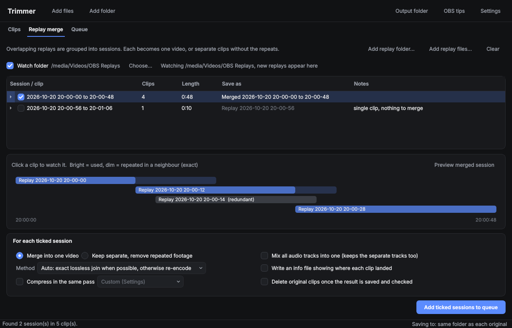

# Trimmer guide

What each tab does, in more detail than the [README](../README.md). Getting started and the
keyboard shortcuts are also in the app, under Help (F1).

## Clips tab

Drop in one clip or hundreds, either as files or whole folders. For each clip you can:

- **Preview and trim** it. Press I and O to mark in and out points, and add
  as many parts as you like to cut out the middle. Space plays, Left/Right
  step one frame, J/L jump 5 seconds, and Delete removes the selected part.
  The timeline shows thumbnails and the audio waveform, so the kill or the
  shout is easy to spot (turn off in Settings → App).
- **Choose audio tracks**: keep any of them, or mix them into one track so
  phones and Discord can hear everything. The separate tracks can be kept too.
- **Compress** with a preset or your own settings: CRF, auto2, auto3, auto
  settings (picks the codec and CRF per clip),
  target file size, lossless, H.264/H.265/AV1, NVENC/QSV/AMF when your GPU
  supports it, optional 10-bit colour for H.265/AV1, and a resolution or frame
  rate cap.
- **Rip** audio tracks (original, WAV, FLAC, MP3, M4A) or the video on its own.
- Compressed files get the settings in their name, e.g. `(LOSSY), (CQ28
  auto2, H265 NVENC, medium)`. Turn this off in Settings → Files.
- Trimmed files get the kept times in their name, e.g.
  `(trimmed 1m05s-1m32s)`; with several parts the first two are listed, then
  `+2 more`. This also applies to each trimmed clip in Replay merge's keep
  separate mode, and to names you type yourself. Turn the times off
  (plain `(trimmed)`) in Settings → Files.
- **Name** the output: type in "Save as" (or press F2). It starts with the
  original name so you can add to it (turn this off in Settings). Ripped
  tracks use the same name.
- **Pick the track you hear** in the preview. Right-click a track to make it
  the default for every clip you open until you close Trimmer.
- **Estimate** the output size before you start.
- **See what's queued**: once a clip is in the queue, its Notes column says
  so ("Queue: Waiting", then "Working", "Done", "Failed" and so on), and the
  same goes for sessions in Replay merge. The note goes away when the job
  leaves the queue.
- **Get rid of a clip you don't want**: right-click it and choose **Move to
  the Recycle Bin** (or press Shift+Delete). The file goes to the Recycle Bin,
  or is deleted outright if Settings say so, and leaves the list. Trimmer asks
  first, and leaves alone any file a waiting job still needs.

The output options apply to every clip, unless a clip has its own: select one
or more clips and change an option, and only those clips change. They get a
★ in the list. **Use shared options** takes a clip's own options away again.
With nothing selected (press Esc, click empty space in the list or **Deselect
all**) the options are the ones for all clips, and new clips start from them.

Lossless trims start at the nearest keyframe *before* your mark, so nothing
you marked is lost. Tick "Frame-exact cuts" if you need the exact frame: it
uses **smart cut**, which re-encodes only the frames between your mark and the
next keyframe (and between the last keyframe and your end mark) and copies
everything else untouched. Saves stay near-instant and nearly the whole clip
keeps its original quality. Smart cut works on H.264 and H.265 clips; every
join is decoded and compared with the original, and if anything doesn't
match, Trimmer re-encodes the whole trim instead and says so in the log.

## Replay merge tab

Don't use the Replay Buffer? Untick Settings > Replay merge > "Show the
Replay merge tab" to hide it.

Drop in your Replay Buffer clips. Clips that overlap in time are grouped into
sessions and drawn on a timeline, and clips that are fully covered by their
neighbours are marked as redundant. Double-click a session (or press F2) to
name its output. Shift-click any session's tick to tick or untick them all.
Tick **Watch folder** and pick your OBS recording folder,
and each new replay appears here, grouped into its session, as soon as OBS
has finished saving it. The overlap view shows the part of each clip that is used
brightly and the repeated footage dimly. Click a clip to watch it: the
viewer highlights the used part, and a playhead on the clip's bar follows
along. Or press
**Preview merged session** to watch a temporary merged video built exactly
the way the real merge would be (nothing is saved). Right-click a session or
some clips (Ctrl or Shift-click to select several) to **send them to the Clips
tab**, each as its own clip, or, for a multi-clip session, to **merge it first**
(a plain lossless merge) so it arrives in Clips as one clip. Either way the
clips leave Replay merge. The same menu (or Shift+Delete) moves unwanted
replays to the Recycle Bin and takes them out of the list. Each session can then be:

- **merged into one video**, or
- **kept as separate clips** with the repeated footage removed.

Like the Clips tab, the merged (or trimmed) videos can keep only some audio
tracks, or mix them into one track so phones and Discord play every track.
**Rip tracks to separate files** also saves chosen tracks as their own audio
files (and/or a video-only file), one set per merged session, or one per trimmed
clip when keeping them separate. You can untick **Save the merged video** to get
only the rips.

These options apply to every ticked session, unless a session has its own:
select sessions and change an option, and only those sessions change (they get
a ★). **Use shared options** takes them away again. With nothing selected
(Esc, a click on empty space or **Deselect all**) the options are the ones for
all sessions.

Tick "Write an info file" to get a text file next to each output that lists
every clip: where it sits in the result, which part of the original was used,
and where the original clip would have ended (in trim mode, which file and
how far into it).

Trimmer first tries an **exact lossless join**: it finds the frames that
the clips have in common, byte for byte, and joins them there, so nothing is
repeated or lost. If the clips don't share frames, it falls back to the old
timestamp and audio-alignment method, and re-encodes at high quality when a
lossless cut would repeat more than half a second.

## Queue

Jobs run one at a time, top to bottom.

- **Pause** freezes the running job exactly where it is, and **Resume**
  carries on from that point. **Pause after this job** lets the current job
  finish first. Quitting while paused cancels the job cleanly.
- **Start jobs automatically** can be turned off, so you can build up a
  queue and press Start when you're ready.
- Each job shows where it **saves to**, what it will do, its **predicted
  size** (then the real size and % saved), and whether it deletes the original.
- Waiting jobs can be changed: double-click a name or folder, or right-click
  one or several jobs to rename them, change the output folder, change the
  compression, turn deleting originals on or off, or move them up or down.
- **Retry** re-runs failed or cancelled jobs with the same settings. Right-click
  a finished job to open it, show it in its folder, or copy its path.
- **When the queue finishes**: do nothing, open the output folder, or put the
  PC to sleep (after a 30-second countdown you can cancel).
- **Space saved** (bottom of the tab) is a running, approximate total of the
  disk space freed by jobs that deleted their originals, plus how much smaller
  all outputs are than their sources. If you delete originals yourself, turn on
  "Count space saved even when originals are kept" in Settings. Edit or reset
  the total there.

A cancelled job never leaves a half-written file. If Trimmer closes or
crashes, unfinished jobs are offered again the next time it starts.

**Crash recovery:** while Trimmer is open it saves what's in the Clips tab and
Replay merge every 10 seconds (each clip's kept parts, names and options, the
sessions' ticks and names). If Trimmer or the PC crashes, the next start
offers to bring all of it back, along with the jobs that were waiting.

**Save state:** when you close Trimmer with clips in the Clips tab, replays in
Replay merge or jobs left in the queue, it asks whether to save them. Saved,
they come back on the next start: each clip's kept parts and output name, the
replay sessions with their ticks and custom names, and the waiting jobs
(started automatically only if "Start jobs automatically" is on). Tick
"Remember my choice" or set **On close** in Settings to stop being asked.
Files that have moved are skipped and listed.

## Tags and warnings

Every video and audio file Trimmer saves carries a hidden note in its
comment metadata, such as `Trimmer: trimmed; then compressed (H.265, q28)`.
Processing a file again adds to it. Before queueing, Trimmer warns when a job
is already in the queue (or finished), or when a file looks already trimmed,
compressed or merged (by that note, or by Trimmer's name tags). Both warnings
can be turned off in Settings → Queue.
